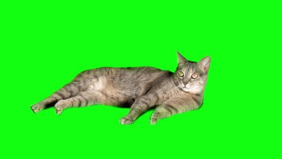
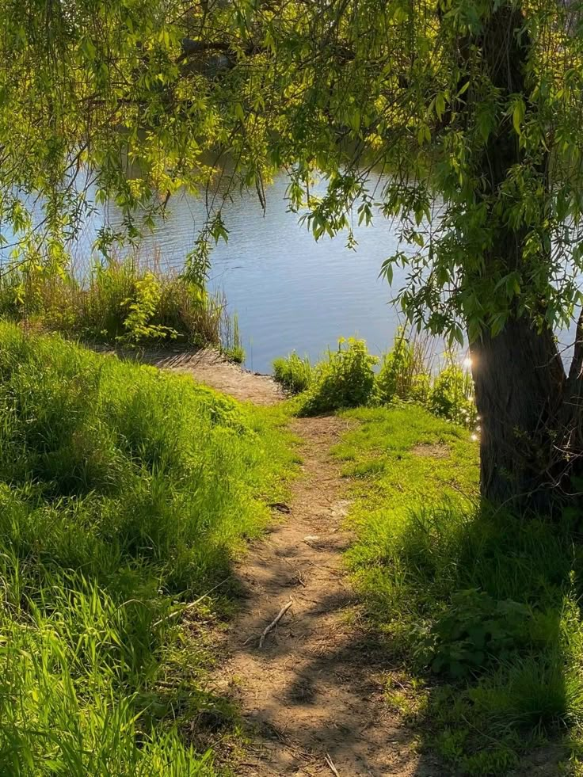
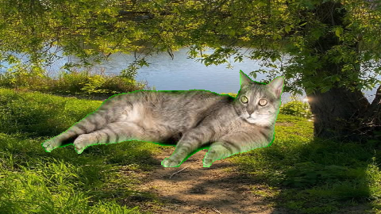

# Лабораторная работа №1. Вариант №5 — Chroma key

**Цель:** реализовать простой алгоритм обработки изображений двумя способами и сравнить их быстродействие.

**Задание:** заданы два изображения и пользовательский диапазон цветов. Заменить пиксели первого изображения, попавшие в диапазон, соответствующими пикселями второго изображения. Реализованы библиотечный вариант на OpenCV и нативный вариант на C++.

## 1. Теоретическая база

Chroma key выделяет пиксели по цвету и заменяет их другим фоном. В этой работе диапазон задаётся в RGB: нижняя граница `(Rmin, Gmin, Bmin)` и верхняя `(Rmax, Gmax, Bmax)`. Значения каналов — целые числа от 0 до 255.

Для пикселя первого изображения `F(x,y) = (R,G,B)` маска равна единице, если одновременно выполняются условия:

```text
Rmin <= R <= Rmax
Gmin <= G <= Gmax
Bmin <= B <= Bmax
```

Границы включаются в диапазон. Результирующее изображение вычисляется так:

```text
C(x,y) = B(x,y), если M(x,y) = 1;
C(x,y) = F(x,y), если M(x,y) = 0.
```

Здесь `B` — второе изображение, `M` — маска. Если нижняя и верхняя границы совпадают, выбирается один точный цвет. Проверяются все пиксели изображения, а не только связанные с краем области.

Обе реализации имеют временную сложность `O(W × H)`. Дополнительная память также `O(W × H)`: нативная версия хранит результат, библиотечная — результат и одноканальную маску.

## 2. Описание разработанной системы

Программа на C++17 и OpenCV содержит две функции и `main`:

- `chromaLibrary` создаёт маску через `cv::inRange` и заменяет выбранные пиксели через `copyTo`.
- `chromaNative` вручную обходит пиксели и проверяет три канала. OpenCV используется как контейнер и для выделения памяти результата.
- `main` читает картинки, запрашивает диапазон RGB, сравнивает время и сохраняет результаты.

Названия выходных файлов: `examples/cat.jpg` и `examples/background.jpg`.

### Сборка и запуск

```bash
cmake -S . -B build -DCMAKE_BUILD_TYPE=Release
cmake --build build
./build/chroma_key
```

Input:

```text
0 180 0
100 255 100
```

Первая строка — нижняя граница RGB, вторая — верхняя. Все каналы должны удовлетворять условию `0 <= нижняя <= верхняя <= 255`. Для одного точного цвета обе границы задаются одинаковыми.

Программа обновляет `examples/result_opencv.png` и `examples/result_native.png`, выводит время каждой реализации и проверяет совпадение результатов.

## 3. Результаты работы и тестирования системы

### Изображения

Использованы предоставленные пользователем картинки: кот 480×270 и пейзаж 736×981. Исходные файлы только переименованы, содержимое не изменено.

| Кот | Новый фон |
| --- | --- |
|  |  |

Результат OpenCV:



Результат нативной реализации:


При диапазоне `(0,180,0)…(100,255,100)` зелёный фон заменился пейзажем. Результаты обеих реализаций совпадают и с результатом до упрощения кода. Вокруг шерсти остался небольшой зелёный ореол: смешанные цвета края не полностью попадают в диапазон.


### Быстродействие

Для каждой реализации выполняется прогрев и 100 повторов. Выводится среднее время одного вызова. В замер входят создание результата и работа алгоритма; чтение картинок, масштабирование, сравнение и сохранение не входят.


| Изображение | OpenCV, мс | Нативная версия, мс | Нативная / OpenCV |
| --- | ---: | ---: | ---: |
| 320×240, демонстрация | 0,0386 | 0,0912 | 2,36 |
| 640×480, демонстрация | 0,1519 | 0,3311 | 2,18 |
| 1280×720, демонстрация | 0,4450 | 0,9966 | 2,24 |
| 1920×1080, демонстрация | 1,0120 | 2,1235 | 2,10 |
| 480×270, кот | 0,0875 | 0,2268 | 2,59 |

На демонстрационной серии время росло примерно пропорционально числу пикселей. В текущем запуске OpenCV быстрее ручного обхода примерно в 4,6 раза. Время зависит от содержимого изображения, компилятора и нагрузки компьютера.

## 4. Выводы по работе

Chroma key реализован двумя способами с пользовательским диапазоном RGB. Границы диапазона включаются, результаты обеих реализаций совпадают. Библиотечная версия быстрее ручного обхода на выполненных замерах.

Жёсткая маска подходит для однородного фона. Узкий диапазон оставляет часть фона, широкий может удалить детали объекта. Сглаживание маски и устранение зелёных ореолов не реализованы.

## 5. Использованные источники

1. [OpenCV: функция inRange](https://docs.opencv.org/4.x/da/d97/tutorial_threshold_inRange.html).
2. [OpenCV: cv::Mat, clone и copyTo](https://docs.opencv.org/4.x/d3/d63/classcv_1_1Mat.html).
3. [OpenCV: чтение и запись изображений](https://docs.opencv.org/4.x/d4/da8/group__imgcodecs.html).
